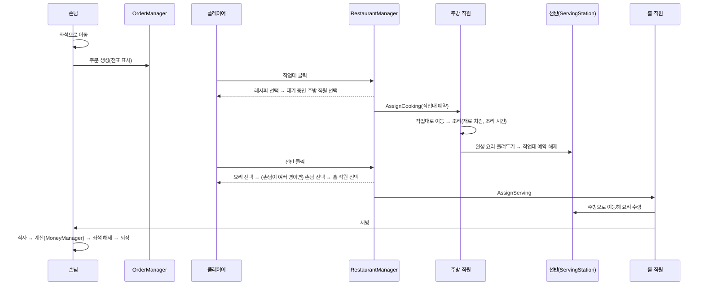
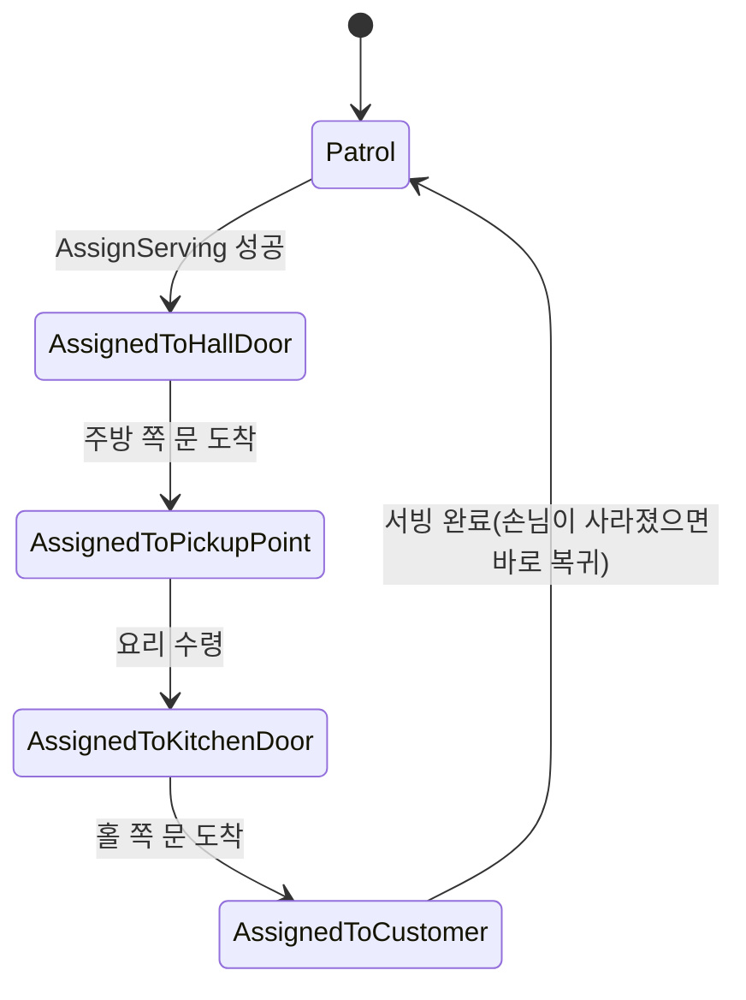
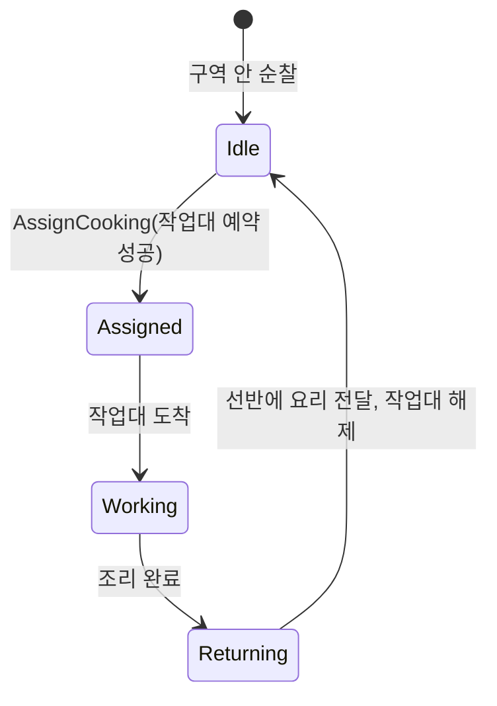
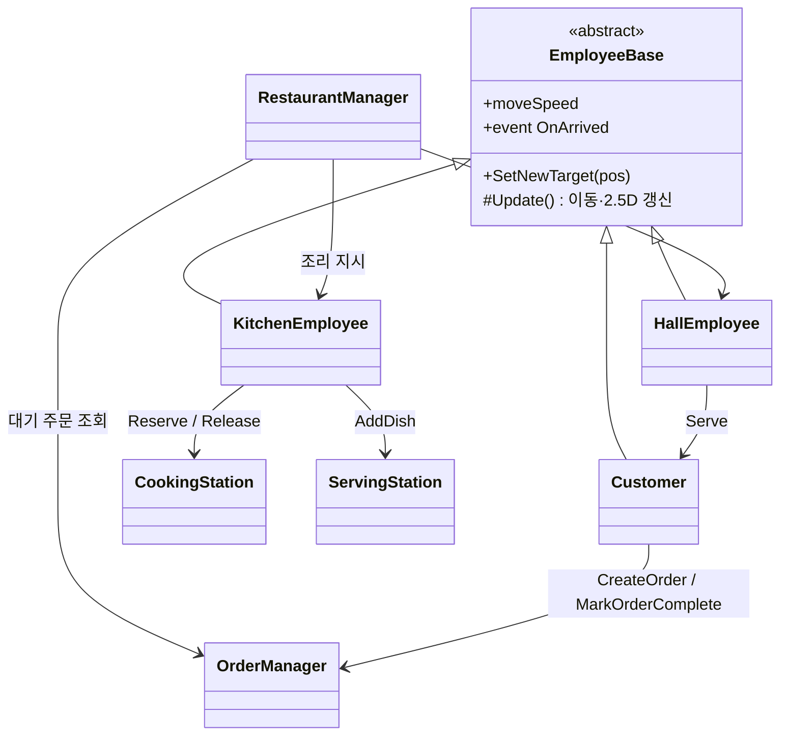

# Devil Dining — 식당 경영 파트 코드 포트폴리오

계원예술대학교 게임미디어과 졸업작품 **《Devil Dining》**(마계식당 경영 시뮬레이션)에서 **제가 작성한 코드만 모은 저장소**입니다.

- 시연 영상: https://youtu.be/nFjP3CCMjTY
- 작품 소개: https://www.gamemedia.kr/title/devil-dining/
- 결과: 졸업작품 최종 발표 1위, 전체 기간 평가 3위

| 항목 | 내용 |
|---|---|
| 팀 | 7명(기획 2, 아트 3, 프로그래밍 2) |
| 기간 | 2025년, 1년(2학년 전체) |
| 엔진·언어 | Unity 6 (6000.0.32f1), C# |
| 사용 기술 | Spine 2D 애니메이션, ScriptableObject, 코루틴, 커스텀 에디터, Git/GitHub |
| 제 역할 | 프로그래머 2명 중 1명. **게임 시작 후 식당 경영 파트 전체** |

## 제가 만든 부분

| 영역 | 내용 | 폴더 |
|---|---|---|
| NPC AI | 손님·홀 직원·주방 직원. 상태 머신과 코루틴으로 움직입니다. | `Restaurant/Employee`, `Restaurant/Customer*.cs` |
| 주문·조리·서빙 흐름 | 주문 전표, 작업대 예약, 플레이어가 직원에게 작업을 지시하는 팝업 | `Restaurant/RestaurantManager.cs`, `OrderManager.cs`, `OrderTicket.cs` |
| 요리 제작 | 레시피·재료 데이터(ScriptableObject), 레시피 해금, 조리 UI | `Cooking/` |
| 인벤토리 | 재료 보유량, 조리할 때 재료 차감 | `Restaurant/Inventory*.cs` |
| 배치 | 미리보기(고스트)를 띄우고 허용 구역에만 놓는 배치 시스템 | `Restaurant/PlacementManager.cs`, `ZoneArea.cs` |
| 2.5D 깊이 | Y좌표 기반 그리기 순서 정렬, 깊이 방향 이동 | `Restaurant/Depth/` |
| 해상도 대응 | PC 가로 화면 고정. 기준 비율을 유지하고 남는 영역은 레터박스로 채움 | `Restaurant/Camera/` |
| 개발 도구 | 커스텀 인스펙터, 깊이·해상도·NPC 디버그 도구 | `*Editor.cs`, `*Tool.cs`, `DepthTest.cs` |

이 저장소에 **없는 것**:
- 다른 프로그래머가 맡은 코드(로비, 직원 채용, 상점, JSON 데이터 구조, 지하 시설, 튜토리얼, 사운드 등)
- 아트·애니메이션 리소스
- 외부 에셋(Spine 런타임 등)

그래서 **이 저장소만으로는 빌드되지 않습니다.** 코드를 읽기 위한 저장소입니다.

## 핵심 플레이 흐름

플레이어가 작업대와 선반을 클릭해 **직원에게 일을 지시**하면, NPC가 스스로 이동하고 작업합니다.

## NPC 상태 머신

**홀 직원** (`HallEmployee.cs`)

**주방 직원** (`KitchenEmployee.cs`)

## 구조

## 구현 포인트

1. **NPC 공통 동작을 추상 클래스로 묶음.** 이동, Spine 애니메이션, 2.5D 등록을 `EmployeeBase` 하나에 두었습니다. 손님·홀 직원·주방 직원은 각자의 상태 흐름만 가집니다. 도착은 `OnArrived` 이벤트로 알립니다.
2. **작업대 예약.** `CookingStation.Reserve()`가 성공해야만 조리가 배정됩니다. 그래서 두 직원이 같은 작업대에 동시에 가지 않습니다.
3. **지시 팝업을 클릭한 위치에 띄움.** 월드 좌표를 화면 좌표로, 다시 캔버스 좌표로 바꿔 팝업을 작업대 옆에 띄웁니다(`RestaurantManager.PositionPopup`).
4. **같은 메뉴가 여러 번 주문돼도 이미 지시한 만큼은 숨김.** `Dictionary<Recipe, int>`로 메뉴별 지시 수를 세고, 팝업에서는 그만큼을 건너뜁니다.
5. **2.5D 깊이.** 화면 아래쪽(Y가 작은 쪽)에 있는 캐릭터가 앞에 그려지도록 Y좌표를 `sortingOrder`로 바꿉니다(`Pseudo3DConverter`).
6. **배치 시스템.** 인벤토리에서 아이템을 고르면 마우스를 따라다니는 미리보기가 뜨고, 아이템마다 정해 둔 구역(`ZoneArea`)에만 놓을 수 있습니다.
7. **개발 도구.** 커스텀 인스펙터(`CookingManagerEditor`, `OrderManagerEditor`)와 깊이·해상도·NPC 디버그 도구를 직접 만들어 테스트 시간을 줄였습니다.

## 문제 해결 기록

### 이미 만든 요리가 다시 '조리 필요'로 뜨던 버그

- **현상**: 요리를 다 만들어 선반에 올렸는데, 아직 서빙 전인 그 주문이 작업대 레시피 팝업에 다시 나타났습니다.
- **원인**: 메뉴별 지시 수(`assignedCount`)를 **조리가 끝나는 시점**에 줄이고 있었습니다. 이 때문에 서빙 전 주문이 '지시 안 됨'으로 다시 계산됐습니다.
- **해결**: 줄이는 시점을 **손님이 요리를 받은 순간**(`Customer.Serve`)으로 옮기고, 주문하지 않은 손님에게는 서빙되지 않도록 조건을 추가했습니다.

### 길찾기 방식 전환 (NavMesh → 상태 머신과 직접 이동)

- 처음에는 2D NavMesh(NavMeshPlus) 기반으로 NPC AI를 만들려고 했습니다.
- 그런데 이 게임은 2D 그림에 깊이를 주는 2.5D 구조라서, 설정을 여러 번 바꿔 봐도 NavMesh가 제대로 동작하지 않았습니다.
- 최종적으로는 NPC 지시 부분을 처음부터 다시 만들어, 상태 머신과 목표 지점 직접 이동 방식으로 정리했습니다.

## 다시 만든다면

- `FindObjectsOfType`로 직원을 찾는 부분을, 직원이 생성될 때 매니저에 등록하는 방식으로 바꾸겠습니다.
- `KitchenEmployee.SetNewTarget`이 `new`로 부모 메서드를 숨기고 있습니다. `override`로 통일해 부모 타입으로 호출해도 같은 동작이 되도록 하겠습니다.
- 디버그 로그를 정리하고, 개발 도구는 에디터 전용 폴더로 분리하겠습니다.
